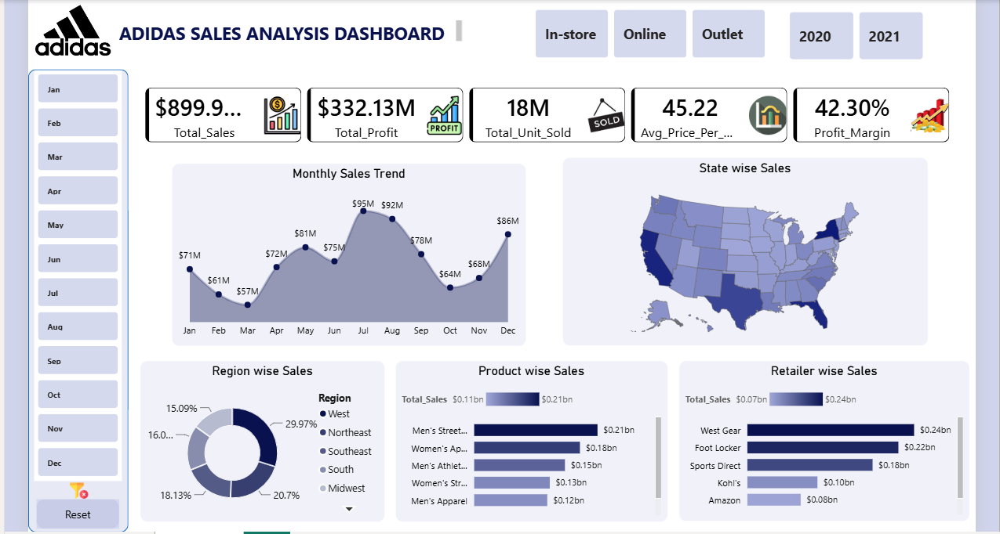

# Adidas Sales Dashboard (Power BI)

An interactive Power BI dashboard that analyzes Adidas sales performance across US states, regions, products and retailers. It helps track revenue, profit and profitability at a glance.

## Key Metrics
- Total Sales
- Total Profit
- Total Units Sold
- Average Price per Unit
- Profit Margin

## Features
- KPI cards for the key business metrics
- Interactive US map showing total sales by state
- Area chart showing the sales trend by month
- Donut chart showing the sales share by region
- Bar charts comparing sales by product and by retailer
- Slicers to filter the dashboard by sales method, year and month

## Tools Used
- Power BI Desktop
- DAX (measures such as Total Sales, Total Profit and Profit Margin)
- Power Query (data cleaning and preparation)

## Dashboard Preview

## Key Insights
- The business generated about $899.9M in total sales and $332.13M in profit, with 18M units sold and a 42.30% profit margin.
- Sales peak in July ($95M) and August ($92M) and are lowest in March ($57M), which suggests strong summer demand.
- The West region leads with 29.97% of total sales, followed by the Northeast (20.7%) and Southeast (18.13%).
- California, Texas, Florida and New York are the top-performing states on the map.
- Men's Street Footwear is the best-selling product ($0.21bn), followed by Women's Apparel ($0.18bn) and Men's Athletic Footwear ($0.15bn).
- West Gear ($0.24bn) and Foot Locker ($0.22bn) are the top retailers, ahead of Sports Direct ($0.18bn).

## Files
- `project.pbix`: Power BI report (open with Power BI Desktop)
- `dashboard.png`: dashboard screenshot

## Data Source
Adidas US Sales dataset (public dataset used for practice).

## Disclaimer
This project was created for learning and educational purposes only. It is not affiliated with or endorsed by Adidas. All brand names and logos belong to their respective owners.

## Author
Arbaz Khan
- GitHub: [khanarbaz786109-svg](https://github.com/khanarbaz786109-svg)
- LinkedIn: [Arbaz Khan](https://www.linkedin.com/in/arbaz-khan-42a96637a)
